<div align="center">

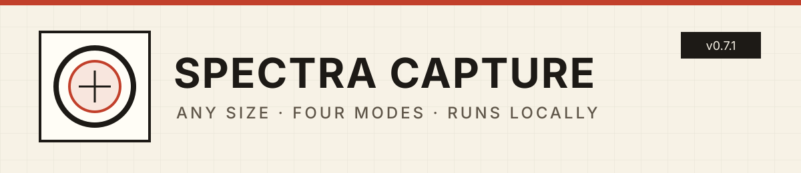

# Spectra Capture

**Screenshots at any viewport size, aspect ratio and pixel density — without DevTools or a high-resolution screen.**

[](package.json)
[](LICENSE)
[](scripts/build.ts)
[](docs/COMPATIBILITY.md)
[](#made-with-ai)

<sub>The banner has a subtle SMIL sweep where supported; it degrades to a clean static image elsewhere. The app itself carries the full motion design — see [Screenshots](#screenshots) and [DESIGN.md](docs/DESIGN.md).</sub>

</div>

Spectra Capture is a free, open-source Chromium extension that saves a picture of the page you are on, at a size you choose. It sets a virtual viewport in CSS pixels, emulates pixel density, captures the visible area or the whole page, and saves PNG or JPEG locally. No page content, image or setting is ever sent over the network.

> **Made with AI, just for fun and trial.** Every line of source code was written by AI assistants; there is no human-written code in this project. See [Made with AI](#made-with-ai).

## Contents

- [Features](#features)
- [Screenshots](#screenshots)
- [Install Bun](#install-bun-build-from-source-only)
- [Quick start — user build](#quick-start--user-build-default)
- [Developer build](#developer-build-with-playwright)
- [Clean reinstall](#clean-reinstall)
- [Installing](#installing)
- [Project structure](#project-structure)
- [Documentation](#documentation)
- [Limitations](#limitations)
- [Licence and attribution](#licence-and-attribution)
- [Made with AI](#made-with-ai)

## Features

- **Any size** — phone (390 × 844) up to 8K (7680 × 4320), or type your own CSS-pixel dimensions. A **Monitor** preset detects your display's resolution on open and adds it as a selectable size at 1×; the existing density controls still apply.
- **Aspect ratios** — lock a ratio while typing, or swap width and height in one click.
- **Pixel density** — 1×, 1.5×, 2× or 3× output without a HiDPI display.
- **Four ways to capture** — visible area, full page, a dragged area, or a single element (buttons, cards, images, sections) picked with a themed, animated on-page overlay that never ends up in the image.
- **Settings tab** — a 3/5/10 s delay for hover states, dark-mode capture, hiding sticky elements, Save As, clipboard copy, a full annotation editor, a save-notification switch and a picker-timeout switch. Picker motion follows the main Motion switch.
- **Tall pages** — very long pages are captured in slices and stitched locally.
- **Safe output** — impossible size/density combinations are disabled in the UI, size gates run before and after capture, and the returned PNG/JPEG header is checked against the expected dimensions.
- **Console** — every step and problem in plain words, with Copy and Clear.
- **Remembered settings** — sizes, theme and motion preference stored locally.
- **Custom UI** — square edges, hard shadows, bespoke buttons and checkboxes, and layered motion that respects reduced-motion settings.
- **Inter everywhere** — one bundled variable font with a full cross-platform system fallback.
- **Theme-aware artwork** — dark logo variants and highlights that adapt to light/dark mode.
- **Audited and local** — source-first security audit, no network calls, no remote code, no all-sites permission.

## Screenshots

Captured from the real built extension.

| Size | Output | Console |
| :--: | :--: | :--: |
| 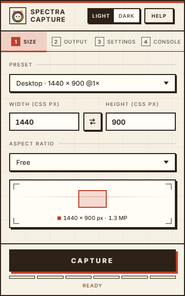 | 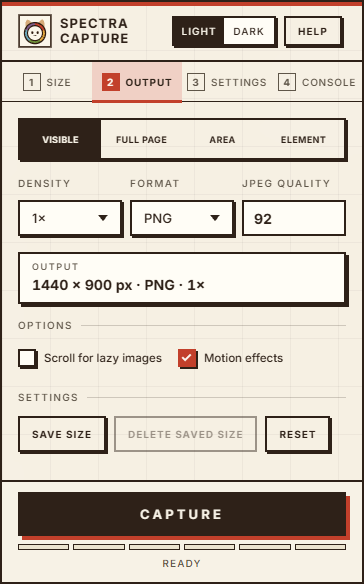 | 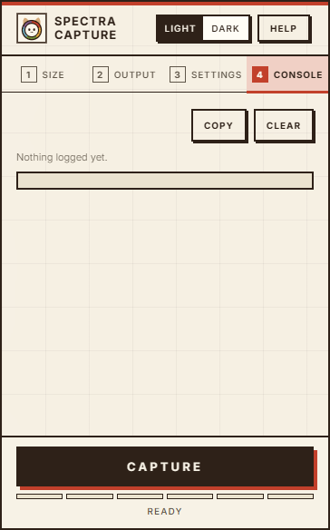 |

| Dark theme | Guide hero | Guide sections |
| :--: | :--: | :--: |
| 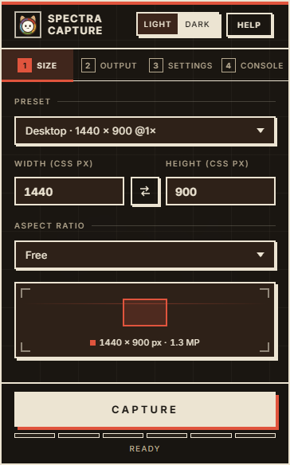 | 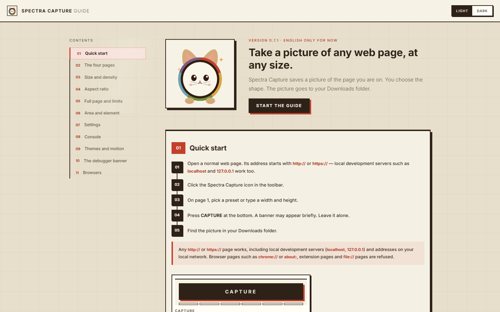 | 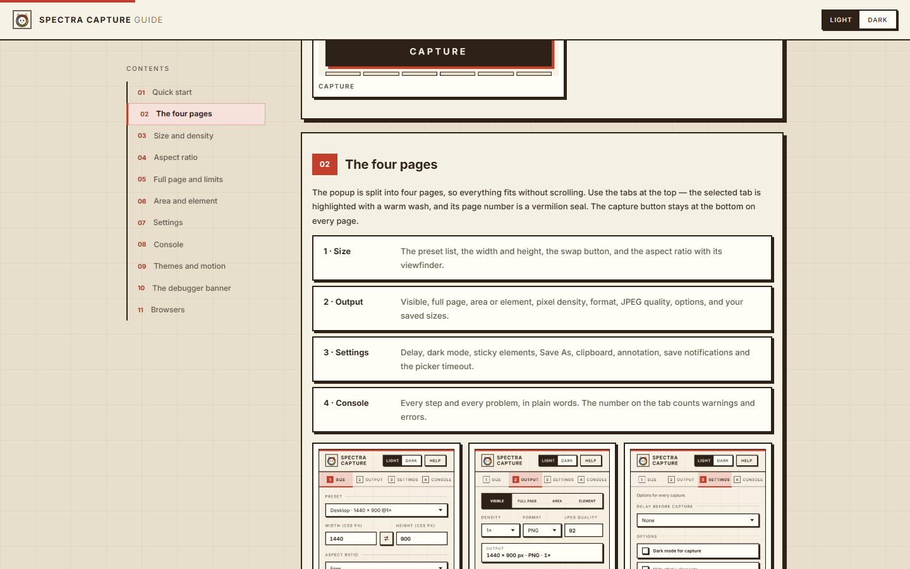 |

Details:

| Size fields | Viewfinder | Output controls | Console tools |
| :--: | :--: | :--: | :--: |
| 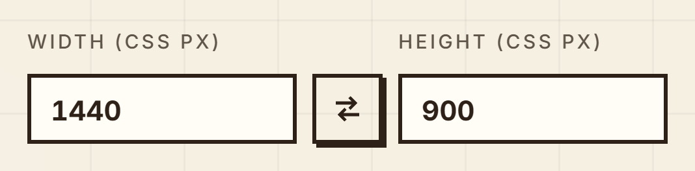 | 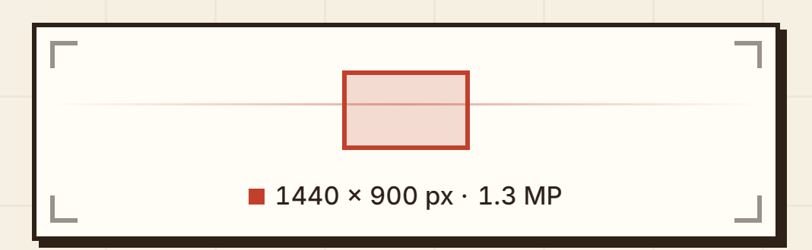 | 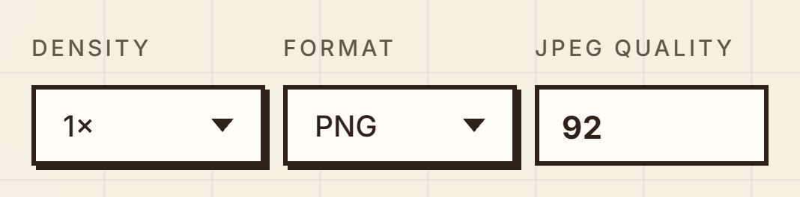 | 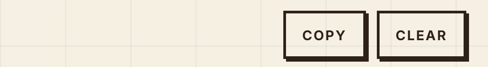 |

All images are generated from the real built extension with `bun run screenshots:pw`.

## Install Bun (build from source only)

Bun is the **only** runtime this project uses — there is no Node.js/npm step. Use [Bun](https://bun.com/) 1.2 or newer: it is a single dependency-free executable, builds the extension with no extra packages, and is faster and safer for this project than a Node toolchain.

Verify after installing:

```sh
bun --version
```

### macOS and Linux

```sh
curl -fsSL https://bun.com/install | bash
```

Linux needs `unzip` (`sudo apt install unzip`); kernel 5.6+ is recommended. If `bun` is not found afterwards, add `~/.bun/bin` to your `PATH` and restart the terminal.

### Windows (PowerShell)

```powershell
powershell -c "irm bun.sh/install.ps1|iex"
```

That line works in **any** Windows shell (it launches PowerShell itself). The `powershell -c` prefix is required in cmd.exe. Requires Windows 10 1809 or newer. If `bun` is not recognised, add `%USERPROFILE%\.bun\bin` to your user `PATH` and restart the terminal.

### Portable Bun (no installer, no admin rights)

Download the zip for your OS from the [Bun releases page](https://github.com/oven-sh/bun/releases), extract it, and call the binary directly — nothing is written outside the extracted folder:

```powershell
# Windows (PowerShell), from the folder containing the extracted zip
.\bun-windows-x64\bun.exe --version
.\bun-windows-x64\bun.exe run build:user
```

```sh
# macOS / Linux
./bun-darwin-arm64/bun --version     # Apple Silicon
./bun-linux-x64/bun run build:user   # Linux x64
```

For portable Bun, replace `bun` with the full path to that binary in every command below.

## Quick start — user build (default)

You do **not** need Bun if you take the ready-made zip.

### Option A — download the built extension

1. **[Download the latest release](https://github.com/BayJoi/spectra-capture/releases/latest)** — that link always opens the newest version. Download the zip attached there (the user build — already built and validated). You never need to look up a version number.
2. Unzip it. You get a single folder named `dist/`.
3. Load it in your browser as described in [Installing](#installing).

### Option B — build from source (still no dev dependencies)

```sh
git clone https://github.com/BayJoi/spectra-capture.git spectra-capture
cd spectra-capture
bun run build:user
```

`bun run build:user` bundles and validates `dist/` using only Bun's built-in bundler. It does **not** need `bun install`, `node_modules`, Playwright, or any other package. Verified: the build works on a fresh checkout with no `node_modules` at all.

Useful user commands:

| Command | What it does |
| --- | --- |
| `bun run build:user` | **Default.** Builds and validates `dist/`, no dependencies required |
| `bun run build` | Same build step (alias) |
| `bun scripts/validate.ts` | Re-validates an existing `dist/` |

## Developer build (with Playwright)

Use this only if you want to run the browser tests or regenerate screenshots. Playwright is a **dev dependency**: it is never bundled into the extension and is not needed for daily use or for the user build.

```sh
bun install          # installs TypeScript, types and Playwright
bun run build:dev    # typecheck + unit tests + build + validation + Playwright suites + screenshots
```

Individual developer commands:

| Command | What it does |
| --- | --- |
| `bun install` | Installs dev dependencies (including Playwright) |
| `bun run check` | Typecheck + unit tests + build |
| `bun test` | Unit tests only |
| `bun run e2e:pw` | Real-browser message-flow check |
| `bun run e2e:pw:popup` | Popup UI, tabs, ARIA and live regions |
| `bun run e2e:pw:guide` | Guide page, images, reveal and theme |
| `bun run e2e:pw:picker` | Picker cleanup, motion and selection regression checks |
| `bun run screenshots:pw` | Regenerates every screenshot (and copies them into `dist/`) |

### Playwright — do you need it?

For daily use or a user build: **no**. It is used only by `development/tests/playwright/` to verify the UI in a real Chromium and to generate documentation screenshots; the extension itself captures with the browser's `chrome.debugger` API. The two release flavours are:

- **User build** — `dist/` only (or the prebuilt zip); no Playwright, no dev dependencies.
- **Developer build** — the full source plus `bun install`, Playwright and the test/screenshot commands above.

### About `bun.lock`

`bun.lock` pins dev dependency versions so developer builds are reproducible. It is **not** needed for the user build or for the built zip, and it is not shipped in the prebuilt release. If it is missing, `bun install` recreates it automatically; keeping it in the developer source is recommended.

## Clean reinstall

To rebuild from scratch (system or portable Bun), delete only these generated items — never the source folders:

| Delete | Why |
| --- | --- |
| `node_modules/` | installed dev dependencies (recreated by `bun install`) |
| `dist/` | generated extension (recreated by a build) |
| `bun.lock` | optional; recreated by `bun install` (delete only to re-resolve versions) |

From the project root, delete exactly these three items — nothing else:

```sh
# macOS / Linux
rm -rf node_modules dist bun.lock

# Windows PowerShell
Remove-Item -Recurse -Force node_modules, dist, bun.lock -ErrorAction SilentlyContinue

# Windows Command Prompt (cmd.exe)
rmdir /s /q node_modules dist
del bun.lock
```

> **Never use a wildcard delete** (`rm -rf *`, `Remove-Item *`) in the project folder. That would erase
> the source, `docs/screenshots/` and `licenses/`. The build only **copies** those into `dist/`; it
> never moves or deletes them. If a source file really is missing, `bun run build:user` now stops
> with a clear preflight error instead of producing a broken build.

Then, in the project folder:

```sh
# User build (no dependencies needed)
bun run build:user

# Developer build
bun install
bun run build:dev
```

If you accidentally deleted a source folder, restore it from the source archive — do **not** try to
recover it from `dist/`, because `dist/` only contains generated copies. To confirm your source is
complete before building, check that `docs/screenshots/` contains PNG files and that `licenses/`
contains `INTER_OFL-1.1.txt` and `THIRD_PARTY_LICENSES.txt`.

Finally, in the browser: open `chrome://extensions`, click **Remove** on Spectra Capture, then **Load unpacked** and select the fresh `dist/` folder. Preferences are stored per extension in the browser, so use the **Reset** button in the popup if you also want default settings.

## Installing

Open a Chromium browser 116 or newer (Chrome, Edge, Brave, Vivaldi, Opera, Helium), go to its extensions page (for example `chrome://extensions`), turn on **Developer mode**, choose **Load unpacked** and select the `dist` folder. The full beginner guide is [INSTALL.txt](INSTALL.txt).

After loading, pin the extension from the toolbar/puzzle menu, open a normal `http://` or `https://` page, click the icon, choose a size and press **CAPTURE**. Your browser's "ask where to save" setting is respected, and a system notification confirms the save (turn this off anytime on the Settings tab).

### Supported pages

Any `http://` or `https://` page works, including:

- local development servers (`http://localhost:3000`, `http://127.0.0.1:8080`, …);
- addresses on your local network (`http://192.168.x.y:…`);
- staging and preview deployments behind HTTP or HTTPS.

Refused: browser internal pages (`chrome://`, `edge://`, `about:`, the New Tab page), extension pages, web-store pages and `file://` URLs. The extension reports this in the Console instead of changing anything on the tab.

## Project structure

Only folders are shown; the build output `dist/` is generated and git-ignored.

```text
spectra-capture/
├── assets/                  # bundled font files
├── brand/                   # original mark and mascot artwork
├── development/             # tests and fixtures — development only
│   └── tests/
│       ├── e2e/             # raw-CDP browser tests
│       ├── fixtures/        # local pages used by browser tests
│       ├── integration/     # manual browser checklist
│       ├── playwright/      # real-extension browser tests + screenshots
│       └── unit/            # Bun unit tests
├── dist/                    # generated extension — load this in the browser
├── docs/                    # guides, decisions and test records
│   ├── assets/              # README banner
│   └── screenshots/         # real screenshots of every screen
├── licenses/                # all third-party licence texts
├── public/                  # manifest and icons
│   └── icons/
├── scripts/                 # Bun build and validation
└── src/                     # extension source
    ├── background/          # service worker + shared job core
    ├── capture/             # debugger session, capture, download
    ├── help/                # guide page
    ├── i18n/                # all English UI text
    ├── offscreen/           # MV3 blob helper
    ├── pages/               # clipboard and annotation pages
    ├── popup/               # popup UI, dropdown, console, motion
    ├── settings/            # preferences and presets
    ├── shared/              # types, messages, errors, logging, storage
    ├── ui/                  # custom button and motion layers
    └── validation/          # dimensions, ratios, filenames
```

The root also contains the manifest-independent project files (README, INSTALL, LICENSE, NOTICE,
CHANGELOG, package.json and bun.lock). The Inter font licence lives in `licenses/` alongside the
third-party licences; the build copies both licence texts into `dist/`.

## Documentation

| Document | What it covers |
| --- | --- |
| [INSTALL.txt](INSTALL.txt) | Step-by-step install |
| [docs/COMPATIBILITY.md](docs/COMPATIBILITY.md) | Supported browsers and limits |
| [docs/SECURITY.md](docs/SECURITY.md) | Permissions, trust boundaries, residual risks |
| [docs/TESTING.md](docs/TESTING.md) | Commands, results, tooling constraints, gaps |
| [docs/DESIGN.md](docs/DESIGN.md) | Palette, typography, controls, pages, motion, a11y |
| [docs/RESEARCH.md](docs/RESEARCH.md) | Dated research with sources |
| [docs/MAINTENANCE.md](docs/MAINTENANCE.md) | Release checklist — how to keep docs and screenshots in sync |

> **Playwright — yes or no?** Yes, for development: it loads the real unpacked extension in a browser to verify the UI, the popup→worker wiring and the guide, and to generate the screenshots in this README. It is **not** what the extension uses to capture screenshots — that is built into the browser via `chrome.debugger`. Playwright is a dev dependency only; nothing is shipped to users.

## Limitations

- **The debugger banner is unavoidable** and appears on every capture.
- **`debugger` is a powerful permission.** Install only from a source you trust.
- **Pixel limits are provisional.** 100 MP total, confirmation above 40 MP. Very tall pages are tiled locally; the 16,384 px single-shot compositor cap is worked around, but extremely large outputs still need memory.
- **No touch/mobile emulation.** The page is rendered with `mobile: false`.
- **Element detection is heuristic.** Buttons and landmarks come from the browser's accessibility tree; "cards" are matched by size, style and DOM structure, so results vary by site.
- **Clipboard and annotation open a tab.** They need a focused extension page; browsers do not let a service worker or offscreen document write images to the clipboard reliably.

## Licence and attribution

Copyright 2026 BayJoi. Licensed under the [Apache License 2.0](LICENSE). The project was previously MIT; 0.6.0 relicenses the original work under Apache 2.0.

- [NOTICE](NOTICE) — required Apache 2.0 attribution.
- [licenses/THIRD_PARTY_LICENSES.txt](licenses/THIRD_PARTY_LICENSES.txt) — all dependencies, the Inter font (SIL OFL 1.1), and inspirations. No code was copied from React Bits (MIT + Commons Clause) or any other motion library; the motion layer is original plain CSS/TypeScript.

Apache 2.0 is permissive, adds an explicit patent grant, and has no copyleft. The SIL OFL 1.1 font licence is shipped alongside the font in every build.

## Made with AI

This extension was created entirely by AI assistants. **No human wrote any of the source code.** It is a fun experimental project shared as a trial — expect rough edges, and please do not treat it as production software. Issues and ideas are welcome, but the code is what it is: machine-written, reviewed and tested as carefully as possible, and released under Apache 2.0 for anyone who wants to play with it. `:)`

---

<div align="center">Built with Bun, plain TypeScript/CSS and a lot of curiosity.</div>
